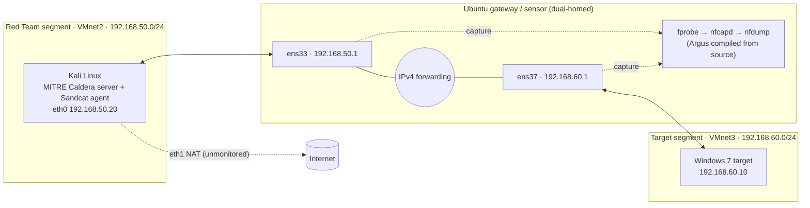

# Lab Architecture

The SentinelAI cyber range is an isolated VMware Workstation lab. All attack and capture activity stays inside host-only networks. The only route out is the attacker VM's own NAT adapter, and the sensor does not monitor it.

## Topology

| Host | Role | Interfaces |
|---|---|---|
| Kali Linux | Red Team: Caldera server and Sandcat agent | `eth0` 192.168.50.20 (VMnet2), `eth1` NAT |
| Ubuntu Server | Gateway and network sensor; routes between the two segments | `ens33` 192.168.50.1 (VMnet2), `ens37` 192.168.60.1 (VMnet3) |
| Windows 7 | Victim / target host | 192.168.60.10 (VMnet3) |

### Why dual-homed
All traffic between the attacker and the target has to cross the Ubuntu gateway, so the sensor sees every attacker↔victim flow at two vantage points (`ens33` and `ens37`). One real ping therefore appears as **4 flow records**: 2 directions × 2 interfaces. The dataset keeps both vantage points and tags each with `capture_interface`.

## Components

| Layer | Tooling | Notes |
|---|---|---|
| Adversary emulation | MITRE Caldera 5.x, Sandcat agent | Abilities run one at a time with manual approval, mapped to ATT&CK IDs |
| Flow capture | fprobe + nfcapd/nfdump on `ens33` and `ens37` | Exported to CSV and mapped to the Argus field schema the AI team asked for |
| Flow capture (planned primary) | Argus (compiled from source) | Kept crashing with a buffer overflow in this lab, so nfdump became the working collector |
| Labeling | Session manifest + time-window correlation | Every flow is joined to a session by timestamp; `label_method = exact_window` |
| Processing | Python / pandas (`scripts/`) | Merge, augmentation, validation |

## Build notes / lessons learned

These are the real problems hit while building the range and how each was solved:

- **Netplan vs. NetworkManager / cloud-init conflicts** on Ubuntu kept resetting the static IPs. Fixed by setting one renderer, turning off the cloud-init network config, and pinning static addresses on both interfaces.
- **VMnet mapping:** adapters were matched to VMnets by MAC address to make sure each VM was on the intended host-only segment. Bridged mode (VMnet0) was rejected because it breaks isolation.
- **Argus** packaged builds were broken. A source build (`-O2`) hit a client/server version mismatch and a flow-flush bug (worked around with `-S 1`), then crashed on every run. **fprobe + nfcapd/nfdump** was put in its place so capture could continue.
- **Sandcat on Windows 7:** current Sandcat builds are compiled with Go ≥ 1.21, which needs system DLLs that Windows 7 doesn't have. PowerShell 2.0 also lacks `Invoke-WebRequest` (a .NET `WebClient` download works). The agent was run on Kali instead, and attacker → target traffic was generated across the gateway.
- **Out-of-scope egress:** a Caldera ping to an external address leaves through Kali's NAT adapter and never crosses the sensor. It is recorded as a zero-flow session (S09) rather than padded with made-up data.
