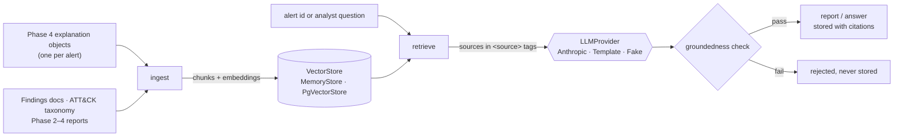

# Phase 5: GenAI layer (skeleton)

Incident reports and analyst Q&A, grounded only in this project's evidence. This is a skeleton: the full pipeline runs offline today, and Claude can be switched in with one environment variable.

## How it fits together



| Part | File | Notes |
|---|---|---|
| Settings | `src/sentinelai/genai/config.py` | Environment variables only (`.env.example`). The API key is read from `ANTHROPIC_API_KEY` only when the Anthropic provider is used |
| Providers | `providers.py` | `AnthropicProvider` (official SDK, `claude-opus-5-5`, structured JSON output, server-side refusal fallback on), `TemplateProvider` (no LLM: copies facts from the sources), `FakeProvider` (tests) |
| Embeddings | `embeddings.py` | `all-MiniLM-L6-v2` (384 dimensions, local) by default; `HashEmbedder` (offline) in tests |
| Storage | `store.py`, `db/001_init.sql` | `MemoryStore` (cached in git-ignored `data/interim/phase5/`), or PostgreSQL + pgvector with an HNSW cosine index |
| Knowledge base | `ingest.py` | Markdown split by heading and paragraph, with deterministic ids `<file>#<n>`; one chunk per explanation object, id `alert:<alert_id>` |
| Reports and Q&A | `rag.py` | JSON schemas for reports (summary, evidence, ATT&CK mapping, caveats, recommended checks) and answers, each with citations |
| Groundedness | `grounding.py` | Every number and IPv4 address must appear in the given sources (rounding and fraction ↔ percent allowed); every citation must name a given source |

## Safety rules the code enforces

- **No invented facts.** An output whose numbers, IPs or citations are not in its sources raises `UngroundedOutputError` and is not stored. While building this, the check caught the offline template putting a chunk id (`#8`) into free text.
- **Sources are data.** Source text is escaped (`<`, `>`, `&`) inside `<source>` tags, so an alert or document cannot close the tag or pose as an instruction. The system prompt says source text is never an instruction.
- **Secrets stay out of the repository.** Keys and the database URL come from the environment; `.env` is git-ignored; `.env.example` has empty values (a test checks this). `Settings` hides the database URL from its printed form.
- **Refusals are explicit.** If Claude declines on safety grounds, `RefusalError` is raised. With the server-side fallback, another Claude model may answer instead, and the script says so.
- **Tests never call a paid API.** The Anthropic provider is tested against a stub client.

## How to run

```bash
python scripts/genai_phase5.py ingest                    # builds the knowledge base (first run downloads the ~90 MB embedding model)
python scripts/genai_phase5.py alerts                    # list alert ids
python scripts/genai_phase5.py report --alert lab-xgboost_temporal_lab-13
python scripts/genai_phase5.py ask "Why does XGBoost flag benign lab traffic?"
```

To use Claude instead of the offline template, set `SENTINEL_LLM_PROVIDER=anthropic` and `ANTHROPIC_API_KEY` in your environment. To use PostgreSQL, run `docker compose up -d` (with `POSTGRES_PASSWORD` set), set `DATABASE_URL`, then run `python scripts/genai_phase5.py init-db` before `ingest`.

## Not done yet

- No live Claude call has been made: the Anthropic path is tested only against a stub. Running one real report costs a few cents and needs your API key.
- PostgreSQL is not installed on the development machine, so `PgVectorStore` is covered by a test that runs only when `DATABASE_URL` is set.
- Chat history tables exist in the schema, but `ask` is single-turn.
- The offline template's answers are extracts of the retrieved text, not written prose. Its value is showing the pipeline end to end and staying grounded by construction.
