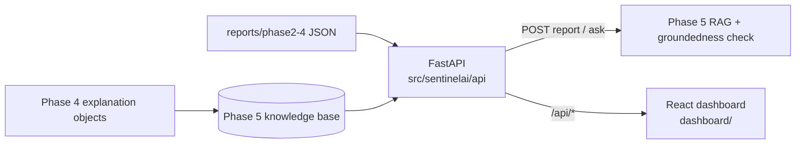

# Phase 6: API + analyst dashboard (skeleton)

A FastAPI backend and a React dashboard over what Phases 2–5 produced. Nothing is simulated: every number comes from a report file or a Phase 4 explanation object, and each panel names its source file. The "alert stream" is a replay of lab capture v1, not live traffic.

## Endpoints

| Endpoint | Returns | Read from |
|---|---|---|
| `GET /api/health` | status, provider, embedder, store | settings |
| `GET /api/summary` | headline numbers, lab flags per model, held-out classes | `reports/phase2/lab_scores_summary.json`, `reports/phase3/{models,loso,lab}.json`, `reports/phase4/holdout.json` |
| `GET /api/evaluation` | per-model test metrics with F1 CIs; leave-one-source-out runs | `reports/phase3/models.json`, `reports/phase3/loso.json` |
| `GET /api/alerts?model=&dataset=&flagged=&stage=` | one row per explanation object | Phase 5 store |
| `GET /api/alerts/{id}` | the full explanation object | Phase 5 store |
| `POST /api/alerts/{id}/report` | grounded incident report with citations | Phase 5 `rag.report_for_alert` |
| `POST /api/ask` `{"question": ...}` | grounded answer with citations | Phase 5 `rag.ask` |
| `GET /api/sources/{id}` | text of a cited source | Phase 5 store |
| `GET /api/timeline` | the 54 lab conversations in capture order with each model's verdict | lab explanation objects, `reports/phase2/lab_scores.csv` (GRU score) |
| `GET /api/attack-matrix` | true tactic × model counts of stored objects | explanation objects, `docs/attack-taxonomy.md` |

Interactive API docs are at `/docs` while the server runs.

## Safety rules the code enforces

- **Local only.** No login, so the server binds to `127.0.0.1` by default and browsers may call it only from the dashboard's origin (`SENTINEL_API_CORS_ORIGINS`).
- **Read-only.** The only writes are generated reports, which the in-memory store keeps until the server stops.
- **No ungrounded output.** A report or answer that fails the Phase 5 groundedness check returns HTTP 422 with the unsupported numbers, IPs and citations, and is not stored. The dashboard shows the rejection.
- **Clear failures.** A missing report file or knowledge base returns 503 with the command to run; a missing `ANTHROPIC_API_KEY` (only needed with `SENTINEL_LLM_PROVIDER=anthropic`) returns 503; any other error returns a generic 500 without internal details.
- **Bounded input.** Questions are limited to 500 characters (`SENTINEL_API_MAX_QUESTION`), ids to 120.

## Dashboard views

| View | What it shows |
|---|---|
| Overview | headline numbers with their source files; lab false alarms per model; held-out attack classes |
| Alerts | filterable list of explanation objects; **replay lab capture** reveals the lab alerts in capture order |
| Alert detail | decision against threshold; TreeSHAP or reconstruction-error bars, or attention with the remove-one-flow test; caveats; **Generate report** with clickable citations |
| Lab timeline | the lab conversations over time, one lane per model, attack conversation marked; lanes can be hidden |
| ATT&CK matrix | tactic × model heat-map of stored objects; models can be hidden; counts or flagged share |
| Models | test metrics with F1 CIs; leave-one-source-out, filterable by feature set |
| Ask | analyst questions answered from the project's evidence, with citations |

Charts are plain SVG; the only runtime dependencies are React and React DOM.

## Tests

- `pytest tests/test_api.py` (18 tests, offline): endpoint shapes, filters, 404s, 422 for ungrounded output with nothing stored, question length, 503 for a missing key, no leaked error details, CORS limited to the dashboard origin, and summary and evaluation numbers equal to the report files.
- `cd dashboard && npm test` (vitest): scales, diverging bars, matrix building and hiding, citation linking, formatting. `npm run build` also type-checks.

## Not done yet

- No login. Add a token (for example from `SENTINEL_API_TOKEN`) before running it anywhere but your own machine.
- No live traffic: scoring new flows as they arrive would need the collector feeding the models, which no phase has built yet.
- Generated reports live in memory and disappear on restart unless PostgreSQL is configured.
- The ATT&CK matrix counts a sample of explanation objects, so it shows coverage, not detection rates.
